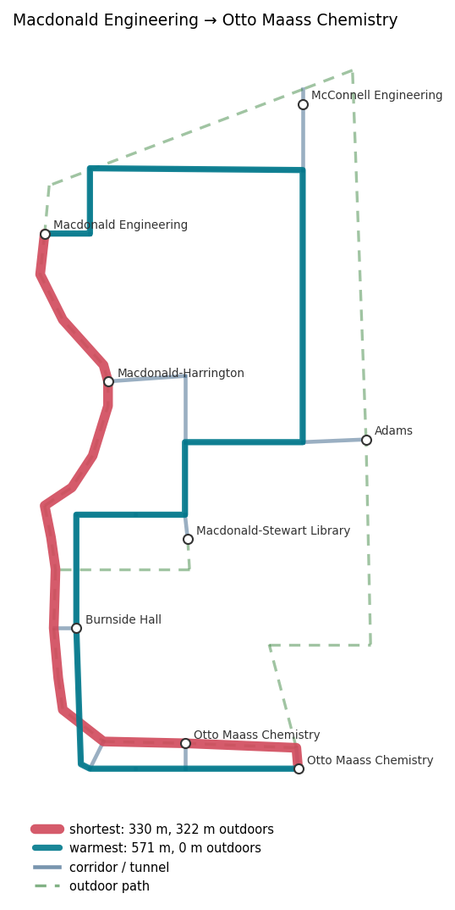
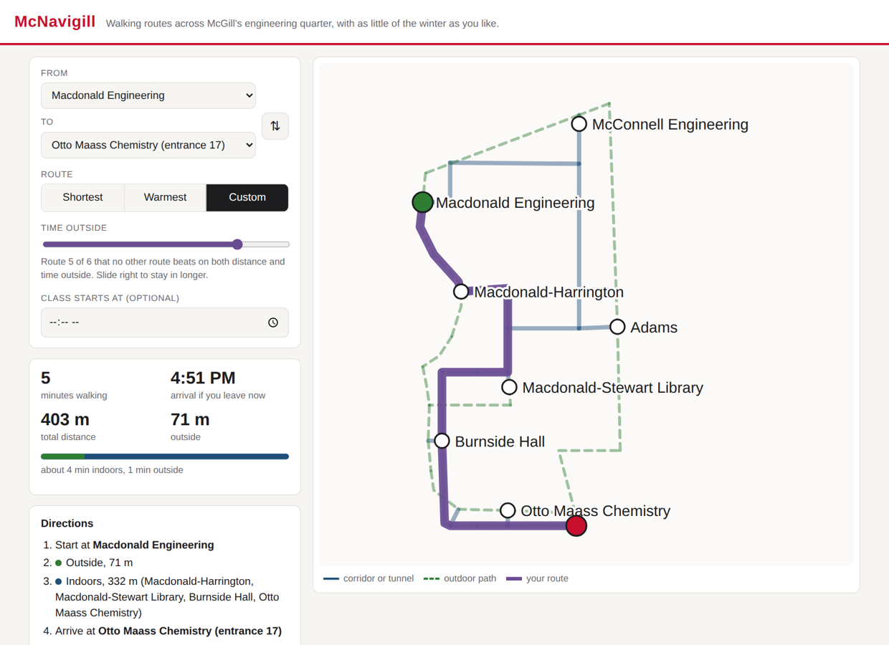

# McNavigill

[](https://github.com/JonasLin2005/mcnavigill/actions/workflows/tests.yml)

Winter routing across McGill's engineering quarter. The campus is a graph of indoor
corridors, underground tunnels and outdoor paths, and a route can be optimised for distance
or for time spent outside. The project began at the McWICS hackathon in January 2025 as a
team of four and was rebuilt as a tested Python package in September 2026.

<p align="center"></p>

From Macdonald Engineering to Otto Maass, the shortest route is 330 m with 322 m of it
outdoors. The warmest is 571 m and never goes outside.

**Web app:** <https://jonaslin2005.github.io/mcnavigill/>

## Web app

`web/index.html` is a static front end: pick a start and a destination, then a shortest,
warmest or custom route. Custom is a slider along the Pareto front, from fastest to fully
indoors. The page shows walking time, arrival time, the indoor/outdoor split, step-by-step
directions and whether you will make a class that starts at a given time; routes can be saved
in the browser and shared by URL.

<p align="center"></p>

The page does no routing itself. `scripts/build_web.py` runs the package's Pareto search for
every pair of entrances and writes the results to `web/data.js`, so the browser and the Python
code always agree; a test fails if the file is out of date. GitHub Actions rebuilds and deploys
it to GitHub Pages on every push. To use it locally, open `web/index.html` in a browser.

## Quick start

```bash
pip install -e ".[dev]"

mcnavigill nodes                                    # list entrances
mcnavigill route "macdonald eng" maass --out route.html
mcnavigill pareto 3 17                              # every non-dominated route
mcnavigill where --out here.html                    # approximate location from your IP
pytest -q
```

`route.html` is an interactive folium map: the network, both routes, and a layer toggle.

## Routing

Every edge carries two integer costs in centimetres: its length ℓ(e), and its outdoor length
o(e), which equals ℓ(e) for an outdoor path and 0 for a corridor or tunnel.

| Objective | Minimises | Tie-break |
|---|---|---|
| `shortest` | Σ ℓ(e) | Σ o(e) |
| `warmest` | Σ o(e) | Σ ℓ(e) |

Both are solved by one Dijkstra implementation (`routing.dijkstra`) on a binary heap with
lazy deletion. The objective is passed in as a lexicographic pair of non-negative costs,
which keeps the greedy step valid, and integer costs make the tie-breaks exact.

`routing.pareto_routes` returns the whole trade-off between the two: every route that no
other route beats on both distance and exposure. It is a bicriteria label-setting search
(Martins, 1984). Labels leave the heap in lexicographic order, so a label is non-dominated at
its node exactly when its outdoor cost is below every label already kept there. Labels that
the destination's front already dominates are pruned. Between the two buildings above, the
front holds six routes, from 330 m / 322 m outside to 571 m / 0 m.

The tests check all three searches against exhaustive enumeration of simple paths for every
ordered pair of entrances (56 pairs).

## The graph

`mcnavigill/data/nodes.csv` and `edges.csv` hold 33 nodes (8 entrances) and 41 edges, digitized
from the team's annotated map in `hackathon-2025/campus-graph-sketch.pdf`. Each edge keeps its
drawn polyline, so lengths follow the path rather than the straight line between endpoints.

The map is in a local metric frame, not latitude and longitude. Its scale (0.38 m per pixel,
`graph.METRES_PER_PIXEL`) is set so that the hackathon's estimate of 200 m from Adams to
Burnside Hall holds, and distances carry that calibration's uncertainty. Folium draws the map in
Leaflet's flat `Simple` CRS with one unit per metre.

IP geolocation (`locate.py`, ipinfo.io) resolves to a city rather than a building, so routes
start from a chosen entrance, not from the reported position.

## Layout

```
mcnavigill/
  graph.py      CSV loading, polyline lengths, validation
  routing.py    Dijkstra (two objectives) and the Pareto search
  render.py     folium route maps
  locate.py     ipinfo.io geolocation
  cli.py        command line
  web.py        exports routes for the web app
  data/         nodes.csv, edges.csv
web/            index.html (the web app) and data.js (generated)
tests/          brute-force checks, CLI and rendering tests
scripts/        build_web.py, draw_figure.py
hackathon-2025/ routing, geolocation and graph files from the prototype
```

## Credits

McNavigill was built at the McGill Women in Computer Science (McWICS) hackathon in
January 2025 by a team of four: Ebell, Christos, Sara and Jonason Lin. At the hackathon,
Jonason wrote the routing and the geolocation. In September 2026 he rebuilt the project as
this package, including the measured campus graph and the web app.

MIT licence.
